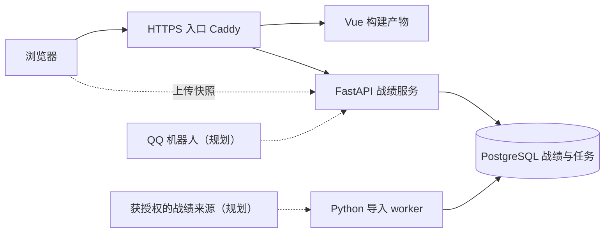

# 卫戍协议战绩平台架构设计

2026-11-22 · 单机自托管方案

## 当前实现

仓库里是一个可以直接部署的个人战绩档案：Vue 3 单页应用调用同源 `/api`，FastAPI 负责登录、角色档案、导入与统计，PostgreSQL 保存战绩，Alembic 管理表结构。

| 模块 | 实现 |
| --- | --- |
| 网页 | `frontend/`：Vue 3 + TypeScript + Vite。四个路由（总览、对局、干员、档案），共享 `context.ts` 里的登录态、当前角色与筛选条件；趋势图用 Chart.js，颜色取自 CSS 变量以跟随深色主题。 |
| API | `backend/logbook/api.py`：会话 Cookie 登录、角色档案 CRUD、筛选分面、总览 / 对局 / 干员查询、快照上传。SQL 只写 PostgreSQL 风格，由 `storage.py` 在选择的后端上执行。 |
| 存储 | `storage.py` 提供两个驱动：PostgreSQL 连接池（默认）与单文件 SQLite。SQLite 侧改写占位符、`now()`、`FOR UPDATE` 与事务语义，并将 `uuid/timestamptz/jsonb/bytea` 映射为 `TEXT/INTEGER/TEXT/BLOB`。 |
| 导入 | `records.py` 校验并规范化快照（现代格式与旧版中文格式），任务写入 `import_jobs`；`worker.py` 逐条消费并做幂等 upsert，接口只负责入队，不等待写库。 |
| 统计 | `stats.py`：胜率、最近十局、盟约总层数与单项峰值、金币 / 击杀 / 回合趋势（近 10 局 / 全部 / 按日）、干员出场与胜率。 |
| 部署 | `compose.yaml` 编排 PostgreSQL、migrate、api、worker、Caddy；`deploy/Caddyfile` 托管静态文件、反代 `/api/*` 并追加安全响应头。 |

历史采集脚本（森空岛与小黑盒的抓包整理、合并补录）只在本地使用，产出 JSON 快照后交给网页导入；个人凭据和原始战绩不入库。

### 界面参考

- 结构基准是仓库根目录 online/dist 的旧版静态站：英雄区横幅、双列趋势图、结算表与战报弹窗；Vue 版按同一结构重写，并补上角色档案与导入。
- 视觉参考 PRTS（prts.wiki）式的深色数据站：近黑底、锐角、发丝级描边、区块标题左侧强调条、紧凑且数值对齐的表格。
- 森空岛 2.5.0 上线卫戍协议攻略工具和战绩页，本项目采用独立的战绩入口与统一深色界面。[森空岛版本记录](https://apps.apple.com/cn/app/森空岛/id6447509138)
- 小黑盒把战绩查询列为游戏工具，把玩法与单局指标放在同一条查看路径中；本项目据此组织为总览、对局列表和单局战报，并在手机上把宽表改为按局浏览。[小黑盒版本记录](https://apps.apple.com/cn/app/小黑盒-八千万游戏玩家社区/id1244505010)

## 技术栈

| 层 | 选型 | 理由 |
| --- | --- | --- |
| 网页 | Vue 3 + TypeScript + Vite + Chart.js | 四个视图共享登录态与筛选，需要组件化与类型检查；构建产物是纯静态文件。 |
| 入口 | Caddy 2 | 自动 HTTPS、静态托管、单行反代；服务器已有 Nginx 时可直接替换成等效配置。 |
| API | Python 3.13 + FastAPI + psycopg 3 | 同步路由跑在线程池，连接池复用；Pydantic 负责导入格式校验。 |
| 数据库 | PostgreSQL 17 + Alembic（默认），可选单文件 SQLite | JSONB 存盟约 / 阵容 / 首领明细，事务与唯一约束保证幂等写入；本机开发与单机部署用 SQLite 免运维，两条路径共用同一套查询。 |
| 运行 | 单机 + Docker Compose | API、worker、数据库在内网通信，只有 Caddy 发布端口。 |

## 正式版架构

同步方向：网页上传快照 → `import_jobs` → worker upsert。未来接入官方授权后，worker 增加“拉取上游战绩”的来源，写入路径与冲突策略保持不变。

## 数据流

1. 浏览器携带会话 Cookie 请求 `/api/roles/{role_id}/...`；`require_role` 校验档案归属。
2. 上传快照时先校验体积与媒体类型，再在 `records.py` 里规范化；校验失败直接 422，不落库。
3. 入队前持有角色行锁，避免同一角色并发堆积任务；队列上限 3 个待处理任务。
4. worker 用 `FOR UPDATE SKIP LOCKED` 取一条任务，在同一事务内按 `(role_id, protocol, external_id)` upsert 全部对局，然后写回 `done` / `failed` 与错误文案。
5. 网页轮询 `/imports`，任务完成后提升数据版本号，四个视图重新拉取。

## 数据库

| 表 | 主键、关系与用途 |
| --- | --- |
| `users` | 平台账号：用户名、Argon2 密码哈希、失败次数、锁定截止时间。 |
| `sessions` | 会话：令牌 SHA-256 摘要主键、所属用户、过期时间。 |
| `roles` | 角色档案：所属用户、名称，`(user_id, name)` 唯一。 |
| `matches` | 单局：角色、协议、外部局 ID、开局时间、方式、难度、胜负、分队 / 策略 / 发起者、回合、击杀、金币、同步次数、奖杯、时长、疑似退出，以及 `bonds` / `squad` / `operators` / `bosses` 四个 JSONB 字段；`(role_id, protocol, external_id)` 唯一，另有 `(role_id, played_at DESC, id DESC)` 查询索引。 |
| `import_jobs` | 导入队列：状态（pending / done / failed）、载荷、总数、已处理数、错误、时间戳；部分索引只覆盖 pending 行。 |

迁移只有一版 `0001_initial`，后续变更通过新增 revision 追加。删除角色档案会级联删除其战绩与导入任务。完整列定义、索引与 JSON 契约见 [DATABASE.md](DATABASE.md)。

### 双后端

| 后端 | 表结构来源 | 事务与并发 |
| --- | --- | --- |
| PostgreSQL（默认） | `alembic upgrade head` | 行锁 + `SKIP LOCKED`，worker 可多实例 |
| SQLite（`LOGBOOK_DB=sqlite`） | `sqlite_schema.py` 启动建表 | `BEGIN IMMEDIATE` 单写者，进程内锁串行，worker 单实例 |

两套 DDL 由 `test_sqlite_schema_matches_alembic_migration` 用 sqlglot 解析后逐表逐列比对，改表必须同步修改，避免漂移。SQLite 侧的时间戳存 UTC 秒、JSON 存文本，读出时由适配层还原类型。

## 统计口径

- 协议期 `V3_1` 展示为「规程协议 1」；难度字段保留原始文案（独立模拟是规程等级，联合模拟是难度名）。
- 日期一律按中国标准时间（UTC+8）归档，筛选的起止日期按当日 00:00 与 23:59:59.999999 换算。
- 单局盟约总层数为已激活盟约的结算层数之和；单项最高层数保留并列盟约名称。明确记录的 0 层计入种类，缺失明细保留为空。
- 干员出场按局去重（同一局重复干员只算一次）；出场率分母是「有阵容明细的局数」，胜率分母是该干员的出场局数。
- 场均金币只统计有金币数据的对局；金币总额同样跳过空值。
- 疑似直接退出按 0 回合、0 金币、0 击杀识别，默认排除，可在筛选里纳入；排除数量会显示在总览上。
- 同步次数来自源字段 `syncCnt`，游戏内具体计数规则仍待确认。

## 部署

**Compose（推荐）**：`docker compose up -d --build`。`migrate` 服务先执行 `alembic upgrade head`，API 与 worker 在迁移成功后才启动；数据库与 Caddy 数据都在命名卷里。发布前端只需要重新构建 `web` 服务。

**裸机**：反代指向 `frontend/dist` 静态目录并转发 `/api` 到 8000 端口，API 与 worker 用 systemd 或进程管理器常驻。迁移在切换版本前执行，数据库按服务器备份策略验证恢复。参考 [FastAPI 部署说明](https://fastapi.tiangolo.com/deployment/concepts/) 与 [Docker Compose 生产部署](https://docs.docker.com/compose/how-tos/production/)。

**反代必须做**：静态目录只托管构建产物；数据库端口不要发布到公网；`PUBLIC_ORIGIN` 与 `SITE_ADDRESS` 保持一致，否则写请求会因 `Origin` 不匹配被拒绝。

## 验收清单

1. 用 `fixtures/sample-snapshot.json` 导入 6 局，核对总览的局数、胜场、排除局数、金币总额与趋势点数。
2. 对局列表按胜负和日期筛选，确认单局战报与列表定位到同一局（回合、击杀、金币一致）。
3. 重复导入同一份文件，确认记录数不增加。
4. 存档一个同名角色，确认返回 409；删除档案后战绩与导入任务一并消失。
5. 用未登录会话访问任一 `/api/roles/*` 接口，确认返回 401 且没有 `Cache-Control` 之外的缓存。
6. 在浏览器里以错误来源提交写请求（例如跨站表单），确认返回 403。

## 后续

- 官方授权绑定流程与增量同步（网页扫码 / 手机跳转、角色选择、凭据加密存储、按外部局 ID 去重）。
- QQ 机器人：绑定、切换角色、战绩、最近一局与最近五局。
- 导入历史去重提示、按协议期归档的统计对比，以及公共素材（干员 / 装备 / 盟约图标）的版本化缓存。

