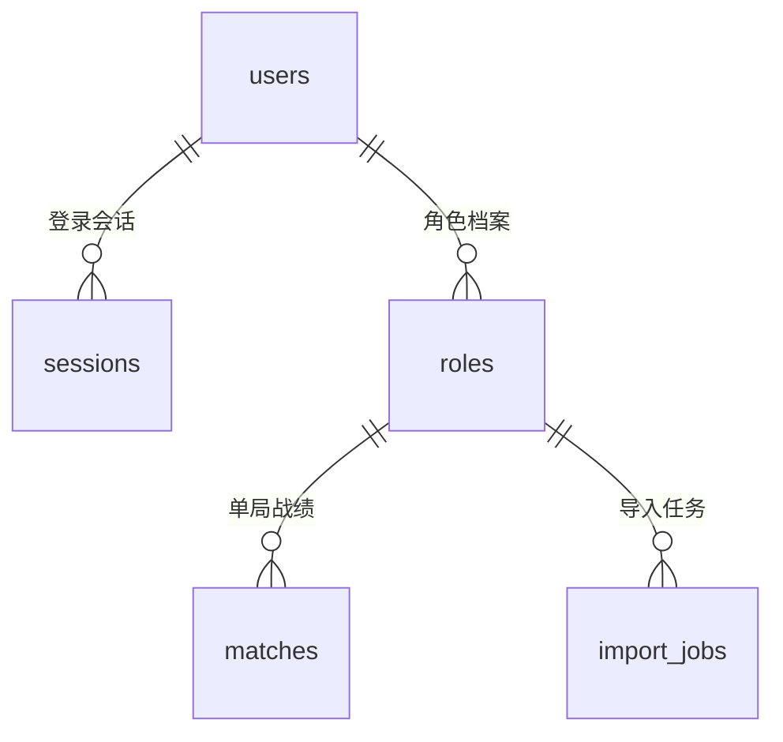

# 数据库结构设计

表结构的唯一来源：

- PostgreSQL：`backend/migrations/versions/0001_initial.py`（Alembic 迁移）。
- SQLite：`backend/logbook/sqlite_schema.py`（启动时 `CREATE TABLE IF NOT EXISTS`）。
- 两者一致性由 `backend/tests/test_storage.py::test_sqlite_schema_matches_alembic_migration` 用 sqlglot 解析 DDL 逐表逐列比对，改表必须同时改两处，否则测试失败。

## 表总览

| 表 | 用途 | 主键 | 唯一约束 | 外键级联 |
| --- | --- | --- | --- | --- |
| `users` | 登录账号 | `id` | `username` | — |
| `sessions` | 会话令牌 | `token_hash` | — | `user_id → users` CASCADE |
| `roles` | 角色档案 | `id` | `(user_id, name)` | `user_id → users` CASCADE |
| `matches` | 单局战绩 | `id` | `(role_id, protocol, external_id)` | `role_id → roles` CASCADE |
| `import_jobs` | 导入队列 | `id` | — | `role_id → roles` CASCADE |

## 列定义

### users

| 列 | PostgreSQL | SQLite | 说明 |
| --- | --- | --- | --- |
| `id` | `uuid PK` | `TEXT PK` | 用户 ID |
| `username` | `text NOT NULL UNIQUE` | 同 | 3–64 位小写字母、数字、`.`、`_`、`-` |
| `password_hash` | `text NOT NULL` | 同 | Argon2id |
| `failed_logins` | `integer DEFAULT 0` | 同 | 连续失败次数 |
| `locked_until` | `timestamptz` | `INTEGER`（UTC 秒） | 达到 8 次锁定 15 分钟 |

### sessions

| 列 | PostgreSQL | SQLite | 说明 |
| --- | --- | --- | --- |
| `token_hash` | `bytea PK` | `BLOB PK` | 只存令牌的 SHA-256 |
| `user_id` | `uuid FK` | `TEXT FK` | 级联删除 |
| `expires_at` | `timestamptz` | `INTEGER` | 7 天有效期 |

### roles

| 列 | PostgreSQL | SQLite | 说明 |
| --- | --- | --- | --- |
| `id` | `uuid PK` | `TEXT PK` | 档案 ID |
| `user_id` | `uuid FK` | `TEXT FK` | 归属用户 |
| `name` | `text NOT NULL` | 同 | ≤60 字符，同名返回 409 |
| `created_at` | `timestamptz DEFAULT now()` | `INTEGER DEFAULT strftime` | 创建时间 |

### matches

| 列 | PostgreSQL | SQLite | 说明 |
| --- | --- | --- | --- |
| `id` | `uuid PK` | `TEXT PK` | 内部 ID |
| `role_id` | `uuid FK` | `TEXT FK` | 归属档案 |
| `protocol` | `text NOT NULL` | 同 | 默认 `V3_1` |
| `external_id` | `text NOT NULL` | 同 | 上游局 ID，幂等键 |
| `played_at` | `timestamptz NOT NULL` | `INTEGER`（UTC 秒） | 开局时间，展示按 UTC+8 |
| `play` | `text NOT NULL` | 同 | 独立模拟 / 联合模拟 |
| `difficulty` | `text NOT NULL` | 同 | 规程等级 / 难度名 |
| `result` | `text CHECK ('win','loss')` | 同 | 胜负 |
| `scenario` | `text` | 同 | 分队 |
| `strategy` | `text` | 同 | 开局策略 |
| `initiator` | `text` | 同 | 策略发起者 |
| `rounds` | `integer` | 同 | 通过回合 |
| `kills` | `integer` | 同 | 敌人击杀 |
| `coins` | `integer` | 同 | 金币花费 |
| `sync_count` | `integer` | 同 | 源字段 `syncCnt` |
| `trophies` | `integer` | 同 | 奖杯增益，可为负 |
| `duration_seconds` | `integer` | 同 | 对局时长（秒） |
| `suspected_exit` | `boolean NOT NULL` | `INTEGER NOT NULL` | 0 回合 + 0 击杀 + 0 金币推断 |
| `bonds` | `jsonb NOT NULL` | `TEXT NOT NULL` | 盟约明细 |
| `squad` | `jsonb NOT NULL` | `TEXT NOT NULL` | 最终阵容 |
| `operators` | `jsonb NOT NULL` | `TEXT NOT NULL` | 出场干员（去重） |
| `bosses` | `jsonb NOT NULL` | `TEXT NOT NULL` | 首领名称 |

### import_jobs

| 列 | PostgreSQL | SQLite | 说明 |
| --- | --- | --- | --- |
| `id` | `uuid PK` | `TEXT PK` | 任务 ID |
| `role_id` | `uuid FK` | `TEXT FK` | 归属档案 |
| `status` | `text CHECK ('pending','done','failed')` | 同 | 状态机 |
| `payload` | `jsonb NOT NULL` | `TEXT NOT NULL` | 校验后的对局数组，写入后置 `[]` |
| `total` | `integer NOT NULL` | 同 | 本批局数 |
| `processed` | `integer DEFAULT 0` | 同 | 已写入局数 |
| `error` | `text` | 同 | 失败原因 |
| `created_at` | `timestamptz DEFAULT now()` | `INTEGER` | 入队时间 |
| `completed_at` | `timestamptz` | `INTEGER` | 完成时间 |

## 索引

| 索引 | 表 | 定义 | 用途 |
| --- | --- | --- | --- |
| `matches_role_id_protocol_external_id_key` | matches | `(role_id, protocol, external_id)` UNIQUE | 重复导入幂等 |
| `matches_recent` | matches | `(role_id, played_at DESC, id DESC)` | 列表分页、总览排序 |
| `roles_user_id_name_key` | roles | `(user_id, name)` UNIQUE | 同名 409 |
| `sessions_expiration` | sessions | `(expires_at)` | 登录时清理过期会话 |
| `pending_import_jobs` | import_jobs | `(created_at, id) WHERE status='pending'` | worker 取任务（部分索引） |
| `role_import_jobs` | import_jobs | `(role_id, created_at DESC)` | 档案页最近导入 |

## JSON 载荷契约

| 列 | 结构 | 示例 |
| --- | --- | --- |
| `bonds` | `[{name, layers}]`，≤100 项 | `[{"name": "维多利亚", "layers": 6}]` |
| `squad` | `[{id, name, items[]}]`，≤150 项 | `[{"id": "char_1012_skadi2", "name": "浊心斯卡蒂", "items": ["chess_item_4_09"]}]` |
| `operators` | `[{id, name}]`，按局去重 | 省略时由 `squad` 派生 |
| `bosses` | `[name]`，≤50 项 | `["霜星", "泥岩"]` |
| `payload` | 校验后的对局数组（1–5000） | 成功写入后置 `[]` |

## 方言差异

业务代码只写 PostgreSQL 风格 SQL，`backend/logbook/storage.py` 在 SQLite 侧改写：

| 语义 | PostgreSQL | SQLite |
| --- | --- | --- |
| 占位符 | `%s` | `?` |
| 当前时间 | `now()` | `CAST(strftime('%s','now') AS INTEGER)` |
| 行锁 | `FOR UPDATE` / `FOR UPDATE SKIP LOCKED` | 去掉；全库单写者 |
| 只读事务 | `SET TRANSACTION ISOLATION LEVEL …` | 跳过该语句 |
| 事务 | 连接级事务 | `BEGIN IMMEDIATE` / `SAVEPOINT` |
| 类型 | `uuid / timestamptz / jsonb / bytea` | `TEXT / INTEGER / TEXT / BLOB` |

SQLite 的时间戳统一存 UTC 秒；适配层读出时转回带时区 `datetime`，写入时把 `datetime` 转成整数秒。

## 后续扩展（未建表）

| 表 | 用途 |
| --- | --- |
| `activities` / `protocols` / `mode_categories` | 活动、协议期、玩法字典；`matches.protocol` 将来改为外键 |
| `match_bonds` / `match_bosses` | 盟约、首领拆表，支持跨用户按盟约聚合 |
| `match_units` / `match_unit_items` | 阵容与装备拆表，支持按装备检索 |
| `game_assets` | 干员 / 装备 / 盟约 / 策略图标按资源 ID + 版本缓存 |
| `user_identities` / `binding_requests` / `game_authorizations` / `game_roles` / `role_bindings` | 网页与 QQ 绑定、加密凭据、角色归属 |
| `sync_jobs` / `sync_runs` | 增量同步任务与运行记录，复用 `import_jobs` 的取任务模式 |

拆表方案：新增明细表后，用一次性回填脚本把 `matches.bonds/squad/bosses` 展开，再删 JSONB 列；接口层保持不变。
